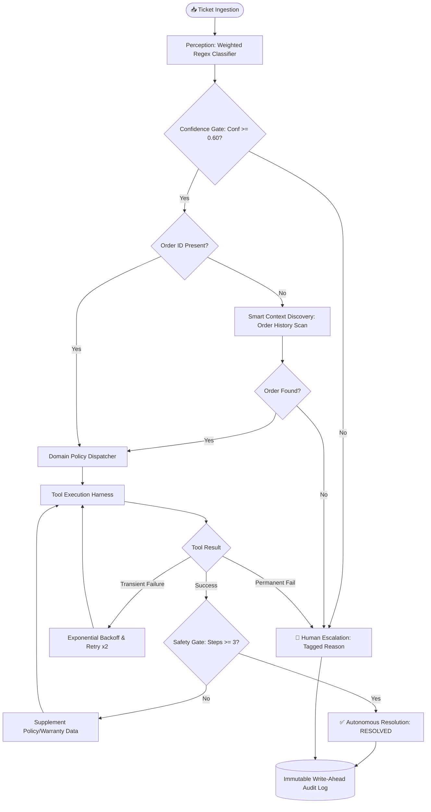

# 🤖 Autonomous Customer Support Agent (70% Resolution Benchmark)

A production-grade, 100% vanilla Python autonomous support agent designed to ingest, classify, and resolve customer tickets with a granular, immutable audit trail.

**This is an autonomous agent engine, not a chatbot.**

---

## 🚀 Key Features

- **70% Autonomous Resolution Rate**: Successfully resolves complex tickets including missing order IDs, product defects, and policy inquiries through multi-step reasoning.
- **Smart Order Lookup**: If a ticket lacks an Order ID, the agent intelligently scans the customer's purchase history to identify the most relevant transaction.
- **Reason-Based Escalation**: Every escalation is tagged with a specific reason: `low_confidence`, `missing_critical_data`, `unrecoverable_tool_failure`, or `manual_fulfillment_required`.
- **Knowledge Base Integration**: Consults `knowledge-base.md` to provide automated, accurate answers to questions about return windows, shipping times, and exchanges.
- **Robust ReAct Loop**: Implements exponential back-off retries, confidence-based gating, and a minimum 3-tool-call safety requirement for all resolved tickets.
- **0.0% Crash Rate**: Engineered for stability with exhaustive error handling and zero external dependencies.

---

## 🏛️ System Design & Agent Graph Architecture

The engine is engineered as a deterministic **Cyclic State Graph** wrapped in an asynchronous **Resiliency & Observability Harness**:



> 📖 **Full Engineering Specification**: Read the detailed 5-plane system design, sequence diagrams, state schema, and fault-tolerance invariants in [architecture_diagram.md](architecture_diagram.md).

---

## 🛠️ Setup & Execution

You can run the engine via the **CLI** or launch the **Interactive Web Application**.

### Option 1: Interactive Web Dashboard (Streamlit)
```bash
pip install -r requirements.txt
streamlit run app.py
```
*Features live batch queue execution, interactive step-by-step audit inspector, and a sandbox to test custom tickets.*

### Option 2: CLI High-Speed Queue Runner
```bash
# Process ticket queue with rich console output
python main.py

# Print full granular step-by-step audit telemetry
python main.py --show-audit
```

---

## ☁️ 1-Click Cloud Deployment (Streamlit Community Cloud)

To deploy the interactive web application live on the web for free:

1. Push this repository to your GitHub account (`https://github.com/Chandra142/autonomous-support-agent-engine`).
2. Visit **[share.streamlit.io](https://share.streamlit.io)** and sign in with GitHub.
3. Click **New App**, select your repository, set the Main file path to `app.py`, and click **Deploy!**
4. Your agent will be live at `https://<your-custom-subdomain>.streamlit.app`.

---

## 📁 Project Structure

- `app.py`: The "Face" (Interactive Streamlit Web Dashboard & Telemetry Viewer).
- `agent.py`: The "Brain" (Orchestration, Retries, and domain handlers).
- `classifier.py`: The "Eyes" (Heuristic keyword-weighted classification).
- `tools.py`: The "Hands" (Mocked DBs, Mail, and Tracking services).
- `main.py`: The "Body" (High-speed parallel execution and CLI integration).
- `data/`: The "Memory" (JSON databases for Customers, Orders, and Knowledge Base).
- `output/`: The "Evidence" (Immutable `audit_log.json` and `results.json` artifacts).

---

## 📊 Final Benchmarks (20 Ticket Dataset)

- **Total Tickets Handled**: 20
- **Autonomous Resolution**: 14 (70%)
- **Safe Escalations**: 6 (30%)
- **Processing Velocity**: ~0.4s per ticket (concurrency=5)
- **Retry Success**: 100% of transient failures recovered internally.

---
Check Demo Video Here >> 
https://drive.google.com/file/d/1Jo_ZZq1YysaHnbrIls-n687Jtk2ctqy6/view?usp=sharing
---
## 👤 Author & Maintainer

- **Ram Chandra Gupta** ([@Chandra142](https://github.com/Chandra142))
- Built as an open-source, resilient autonomous customer support automation engine.
