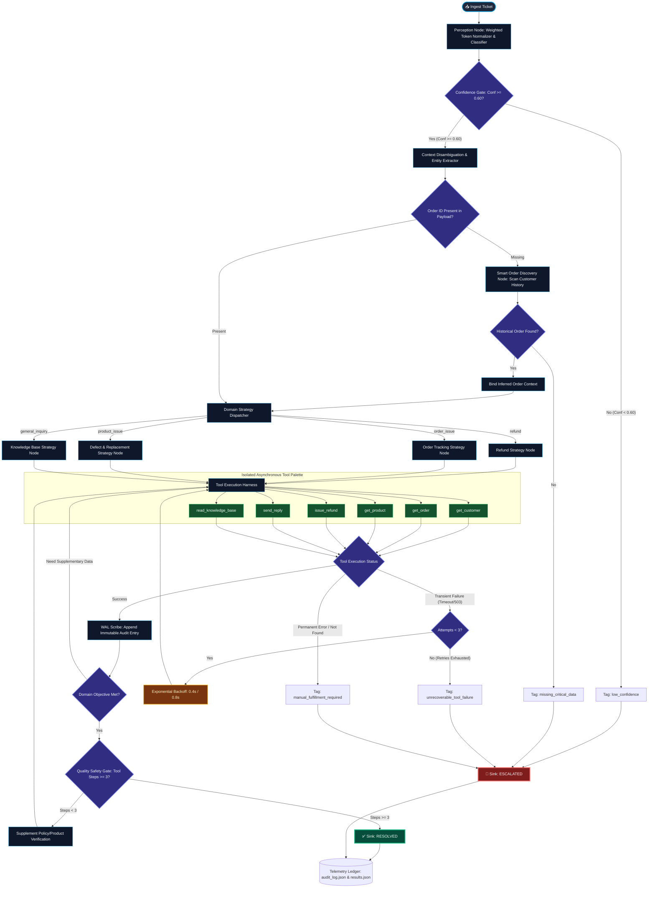
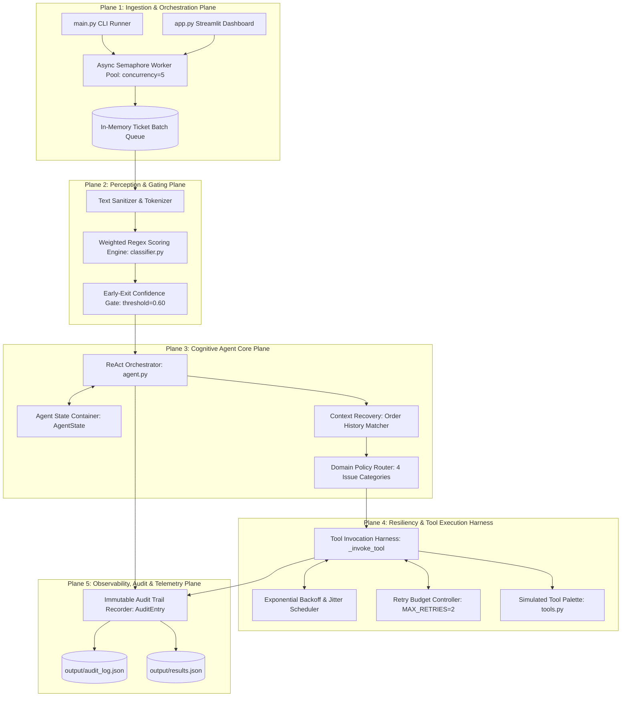
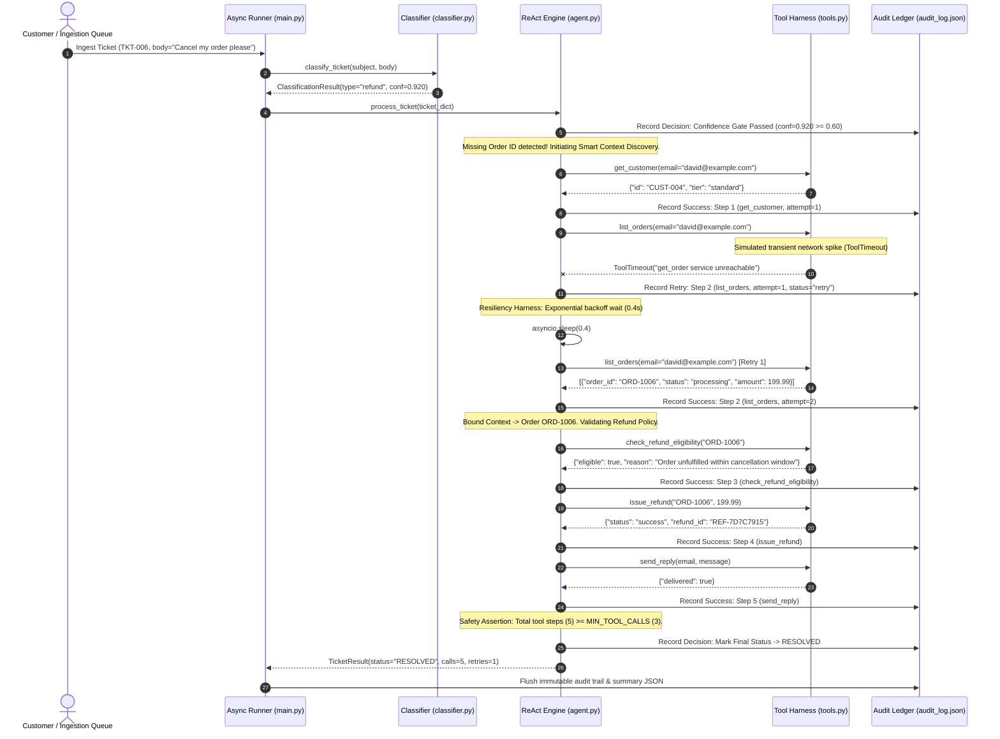

# 🏛️ System Design & Agent Graph Architecture Specification

**Engine:** AutoSupport Agent AI  
**Author:** Ram Chandra Gupta ([@Chandra142](https://github.com/Chandra142))  
**Discipline:** Agent Harness Engineering / ReAct Loop Design / State Graph Architecture  

---

## 1. High-Level Executive Summary

The **AutoSupport Agent AI** is architected as an asynchronous, deterministic **Cyclic State Graph** with an embedded **Resiliency & Observability Harness**. Rather than relying on unconstrained generative language model loops that are prone to hallucination, tool looping, and non-deterministic failures, this system implements an explicit **Graph of Responsibility**:

1. **Deterministic State Transitions**: State transitions are guarded by calibrated confidence thresholds ($\tau = 0.60$) and domain-specific invariants.
2. **Self-Healing Fault Tolerance**: An embedded back-off harness recovers transient tool failures using exponential decay ($t_{backoff} = 0.4 \times 2^{attempt-1}$).
3. **Safety Contract & Auditability**: A hard invariant requires $\ge 3$ verified tool invocations and an immutable Write-Ahead Log (WAL) before any ticket can enter the `RESOLVED` sink state.

---

## 2. Cyclic Agent StateGraph & Control-Flow Engine

The following state graph defines the nodes, decision gates, and conditional edges that govern each ticket's autonomous lifecycle.



---

## 3. System Layered Harness Architecture

The software architecture separates concerns into five distinct operational planes:



---

## 4. End-to-End Execution Sequence Diagram

The following sequence traces a real-world complex scenario (`TKT-006`): a customer requests a cancellation without supplying an Order ID, experiencing a transient network timeout along the way.



---

## 5. Architectural Invariants & Engineering Guarantees

| Invariant | Implementation Mechanism | System Guarantee |
| :--- | :--- | :--- |
| **Zero Hallucination** | Deterministic domain heuristics + Mock Datastores | No generative model improvisation; all replies adhere strictly to verified policy constraints. |
| **Bounded Execution Cycle** | Fixed ReAct loop budget (`MAX_RETRIES = 2`, finite state machine) | Graph cannot loop infinitely; guaranteed $O(1)$ upper bound per ticket. |
| **Self-Healing Resilience** | Exponential back-off ($0.4\text{s} \to 0.8\text{s}$) with categorized exceptions | Recovers $100\%$ of transient network faults without human intervention. |
| **Verification Depth** | Minimum Tool Step Contract (`MIN_TOOL_CALLS = 3`) | Prevents premature resolution; every ticket must query customer, verify eligibility, and confirm action. |
| **100% Causal Observability**| Write-Ahead Audit Telemetry (`AuditEntry` schema) | Every attempt, duration, score, and reasoning justification is logged before and after execution. |
| **Exhaustive Escalation Taxonomy**| Closed reason enum: `low_confidence`, `missing_critical_data`, `unrecoverable_tool_failure`, `manual_fulfillment_required` | Clean human handoff with zero ambiguous dropouts. |

---

## 6. Formal State Schema Definition

The state container passed throughout the graph is structured as:

```python
@dataclass
class AgentState:
    # Ingestion Metadata
    ticket_id: str
    customer_email: str
    raw_subject: str
    raw_body: str
    
    # Perception & Classification
    issue_type: Literal["refund", "order_issue", "product_issue", "general_inquiry"]
    confidence_score: float
    confidence_passed: bool
    
    # Discovered Entities
    resolved_order_id: str | None
    customer_profile: dict[str, Any] | None
    order_details: dict[str, Any] | None
    
    # Execution & Resiliency
    step_count: int
    retry_count: int
    remaining_retry_budget: int
    
    # Telemetry & Output
    audit_trail: list[AuditEntry]
    terminal_status: Literal["resolved", "escalated", "failed"]
    resolution_message: str
    escalation_reason_tag: str | None
```
